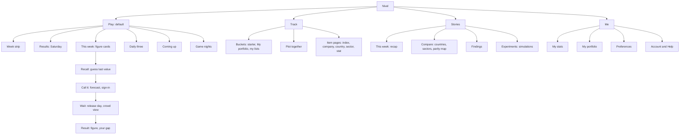

# Information architecture v2

Agreed with the owner on 7 October 2026 (PARITY-105). A shareable page with the diagram: https://claude.ai/artifact/4XTDh9jifb2JDZ6HLi8UBK (private until shared). Play and the weekly markets ([decision 0018](../decisions/0018-weekly-market-cycle.md)) move from the edges of Nivel to its centre. The [design system](../design.md) still governs every page. The [personas and journeys](../research/personas-and-journeys.md) are the people this serves.

## 1. The owner's decisions
1. **At most four tabs:** Play, Track, Stories and Me.
2. **Play is the default page.**
3. **Play has no Guess/Forecast switch.** It tells a real story: the week of figures, like fixtures. Positions sit with the forecasts they belong to.
4. **One list for every item.** Indexes, companies, countries and sectors share one base metric, so they are tracked and plotted together. A type indicator tells them apart, Kite-style buckets group them, and search filters by type.
5. **Stories** holds today's Compare content and Nivel's data stories.
6. **Me** holds my stats, my portfolio and preferences. Its structure is the same signed in or out.
7. **Forecasting is the only action that asks for sign-in.**
8. **Meta is supportive:** method and how the cycle works appear where they are needed, never as tabs. The theme switcher leaves the top bar.

## 2. The affinity map
Everything a user does was grouped by the question they ask:

| Cluster | Items | The user's question |
|---|---|---|
| A figure | Index headline, members, sectors, trend; a company's figure, peers, calculations and sources; official statistics such as PLFS | What is the number? |
| Guess it | Guess first, the daily three, Spot the Stereotype reveals | Did I know it? |
| Forecast it | Weekly markets on a figure's next release; prices; closing times; results | What will it be next? |
| Compare | Countries, sectors, parity map | How does it stack up? |
| Me | Feathers, positions, guesses, calibration, portfolio, account | How am I doing? |
| Trust | Method, sources, the market log, corrections, data API | Can I believe this? |

**What the map showed:**
- Guess and Forecast are two beats of one story about a figure: recall the last value, call the next one, see the truth. So Play is organised around figures, not modes.
- The figure clusters (indexes, companies, countries, sectors) share one base, so they are one list (Track).
- Compare and the data stories are things Nivel *tells*, so they go to Stories.
- Trust is supporting material, opened where a claim is made.

## 3. The structure

**The frame on every page:**
- **Tab bar:** Play · Track · Stories · Me. It sits in the top bar on desktop and the bottom bar on phones.
- **Header:** the logo and search only.
- **Footer:** Method, How the cycle works, Data API, Report a correction, Privacy, and the theme control (Auto, Light, Dark).

### 3.1 Play: the week of figures, told like fixtures
Sports apps (Fixtured, FotMob, the MLS app) lay out results, today and what's coming on one timeline. Nivel's weekly cycle has the same shape, with three moments:
- **Sunday 21:00:** forecasting opens.
- **A weekday:** a publisher puts its figure out, such as MoSPI's PLFS bulletin. That is the fixture, and trading closes the night before.
- **Saturday:** results day.

**Words in the interface:** say a figure is *out* ("PLFS out Tuesday"), never *release*. "Release" is used internally for two things: the publisher's publication a market settles on, and Nivel's own data release.

| Part | What it holds |
|---|---|
| Week strip | Sunday to Saturday; release days dotted, results day starred |
| Results | Saturday: last week's figures flipped to their values, with who was right and your record |
| This week | One card per figure, each at its own beat |
| Daily three | On days with no release: three Nivel figures to guess, with your streak (like a daily-puzzle home) |
| Coming up | Next week's figures, from "Opens Sunday 9pm" |
| Game nights | Spot the Stereotype live sessions |

**Every figure card has four beats:**
1. **Recall:** guess last period's value on a slider, then see the reveal. No account is needed.
2. **Call it:** "Will it be at least X?" A forecast with Feathers. This is **the only sign-in trigger**: a sheet asks for the date of birth, then sign-in, then returns to the same card. Your position then shows on the card.
3. **Wait:** the release day, and the crowd's view ("62 out of 100 say yes").
4. **Result:** the figure, who was right, and your gap.

Before markets switch on, beat 2 is hidden, and Play still works as recall, reveal and results.

### 3.2 Track: one list, buckets, plot together
**One row for everything:** an avatar, the name, a tag, the figure and its change. Type is never shown by colour alone.

- **Every row shows its change.** For yearly figures it is like-for-like from the year before: the same companies in both years, as the data API's `yoy` gives it. For monthly series it is from the month before, until a year of history exists (PLFS's monthly series began in 2025).
- **A country's figure is its broadest tracked index for now:** the Nifty 500 for India, the FTSE 350, ASX 300, TOPIX 500 and STOXX 600's 100 largest EU members. A figure across every covered company in the country would be a new calculation (owner decision).
- **A sector's figure** is its companies within that market's broadest index, such as the 24 IT companies in the Nifty 500.

Examples from Nivel's data of 5 October 2026:

| Row | Figure | Change |
|---|---|---|
| Nifty 50 | 20.85% | +0.34 pts, 42 companies like-for-like |
| Infosys | 29.15% | +0.09 pts |
| India (Nifty 500) | 19.38% | +0.28 pts, 358 companies |
| IT, India (24 companies) | 25.73% | +0.12 pts |
| PLFS women's participation, October 2025 | 34.2% | +0.1 pts on September |

| Type | Avatar | Tag (also gives scale) |
|---|---|---|
| Company | Its logo | `NSE`, `LSE`, `ASX` |
| Index | Monogram tile, such as "N50" | `INDEX · 50` |
| Country | Flag | `COUNTRY · NIFTY 500 BASIS` |
| Sector | Sector glyph | `SECTOR · 23 cos` |
| Official statistic | Publisher monogram | `PLFS · monthly` |

**The rest of Track:**
- **Buckets:** switchable lists across the top, like Kite's numbered marketwatch lists and Fidelity's "Manage watch lists". There is a starter bucket of headline indexes and countries, so a first visit is never empty. Then come My portfolio (shared with Me) and the user's own lists. Buckets live on the device, and sync when signed in.
- **Plot together:** any mix on one chart. Every item shares one scale, so there is never a second axis.
- **Search:** an icon on every tab, with type chips: All · Indexes · Companies · Countries · Sectors · Explainers.
- **Item pages share one template:** the figure, its trend, related items (an index's members, or the indexes a company belongs to), "How it's made", and "Play this figure" when the item has a guess or an open market.

### 3.3 Stories: what Nivel tells
| Section | Holds |
|---|---|
| This week | Saturday's recap: the week's figures and how players' forecasts compared |
| Compare | Today's Compare pages as evergreen stories refreshed each release: the markets side by side, sectors across markets, the parity map |
| Findings | Data stories |
| Experiments | Equal 50, Parity 50 and the Parity-Aligned Nifty 500, labelled as simulations |

Every story ends with a way back in: track these figures, or forecast the next one. Groww's explainers do the same, ending with an action button.

### 3.4 Me: the same page signed in or out
| Section | Holds | Signed out |
|---|---|---|
| My stats | Guess accuracy, streak, calibration (how far your beliefs sit from the data), forecast record, Feathers | Guesses and streak from this device; Feathers and forecasts show "Make a forecast to earn Feathers" |
| My portfolio | The women's-pay footprint of the funds and stocks you hold | Works fully, on this device (CAS read on the device, PARITY-39) |
| Preferences | Theme, default market | Works fully, on this device |
| Account and Help | Sign in or out, delete my data; method and how the cycle works | "Sign in" |

Signing in adds syncing and forecasting. The page keeps its shape, as CNBC's and Yahoo Finance's do: only the inside of a section changes.

**Two words that must not mix:** *portfolio* is real investments; *positions* are play-money forecasts. They live in different places, which also keeps real and play money apart, as the [Gaming Act check](../reviews/gaming-act-check-2026-10.md) requires.

### 3.5 Meta
- **Where it opens:** method and how the cycle works open as short sheets (what, why, how) from the figure or market they explain, as Robinhood explains order types where they are chosen.
- **Full versions:** in the footer and Me → Help.
- **Search:** explainers appear in search under their own chip.

## 4. Addresses
| Address | Page | Replaces |
|---|---|---|
| `/` | Play | Home's index list, which moves to Track's starter bucket |
| `/track`, `/track?bucket=` | Track | `/companies` (redirects to `/track?type=company`) |
| `/index/{id}`, `/company/{symbol}` | Item pages | Unchanged |
| `/country/{code}`, `/sector/{slug}`, `/stat/{subject}` | New item pages | Parts of `/compare` |
| `/forecast/{id}` | A market | `/market?id=` (redirects). Needs the page function to accept a pattern, as it does for companies |
| `/stories`, `/stories/{slug}` | Stories | `/compare/*` (redirects to the matching Compare story), the simulation pages |
| `/me` | Me | `/wallet` (redirects) |
| `/method` and the explainers | Meta | Unchanged, no longer in the tab bar |

Every new address needs a place in `prerender-routes`, so the next data publish lists it in `app/pages.json`.

## 5. Research evidence
The research was done on Lazyweb on 7 October 2026, with five agents, one per app named by the owner. Lazyweb has no in-app screens for Kite, Coin, Vested or CRED, and only Groww's website, so the agents used close analogues. Kite's numbered lists and segment tags are noted from general knowledge.

| Pattern | References |
|---|---|
| One list mixing types, with the same columns | Bloomberg and Reuters watchlists (stocks and indexes in one table); Koyfin (a type tag per search result) |
| Several named lists, prefilled for signed-out users | Fidelity ("Manage watch lists"), E*TRADE (list switcher), Bloomberg (featured starter list), Groww ("Portfolios on Groww") |
| Type chips under search | Coinbase (All, Tradable, Watchlist …), Zora (type chips), Groww (search in the header on every page) |
| Positions with an Open/Closed toggle | Fidelity (Portfolio → Positions) |
| Same tab and structure signed out | CNBC (Watchlists with an in-place sign-in panel), Yahoo Finance (Portfolio explains, then signs in), Bloomberg |
| Sign-in at a gated action, in a sheet | Bilt (Log in / Create account sheet); everything else stays open |
| Theme under settings, "same as device" | E*TRADE, Wise, Mercury, Bobby |
| Explainers in context, ending in an action | Robinhood (inline order-type help), Groww (explainers end with a product button), CRED (footer of guides and FAQs) |
| Fixtures timeline | Fixtured, FotMob, MLS |
| Daily-challenge home | Crossword Chef, NYT Games |

## 6. The build, in stages
| Ticket | Stage |
|---|---|
| PARITY-106 (IA-0) | Card sort and tree test with 15 to 20 people across the personas |
| PARITY-107 (IA-1) | Shell: four tabs, Play as default, header and footer, the theme moved, redirects |
| PARITY-108 (IA-2) | Track: rows, avatars and tags, buckets, search chips, plot together, item pages |
| PARITY-109 (IA-3) | Play: the week of figures and its four beats |
| PARITY-110 (IA-4) | Stories: recap, Compare, findings, experiments |
| PARITY-111 (IA-5) | Me: stats, portfolio, preferences, account; the same signed in or out |
| PARITY-112 (IA-6) | Official statistics in the release, with `/stat/` pages, starting with the PLFS monthly bulletin |
| PARITY-113 (IA-7) | Meta: info sheets, footer, Me → Help |

**Order:**
1. IA-0 first, so the structure is tested before it is built.
2. Then IA-1 and IA-7 together.
3. Then IA-2 and IA-5, which share buckets and My portfolio.
4. Then IA-6 and IA-3, since Play's official figures need stored history.
5. Then IA-4.

Play's forecast beat waits on markets switching on (counsel, PARITY-51, and safeguarding, PARITY-49).

## 7. Open questions
- **Play needs enough to show before markets are on.** Daily three and the recall beats should carry it, and the tree test will tell.
- **Mixing types in one list may confuse.** The tree test should check that a mixed starter bucket reads clearly, or show whether buckets must start out single-type.
